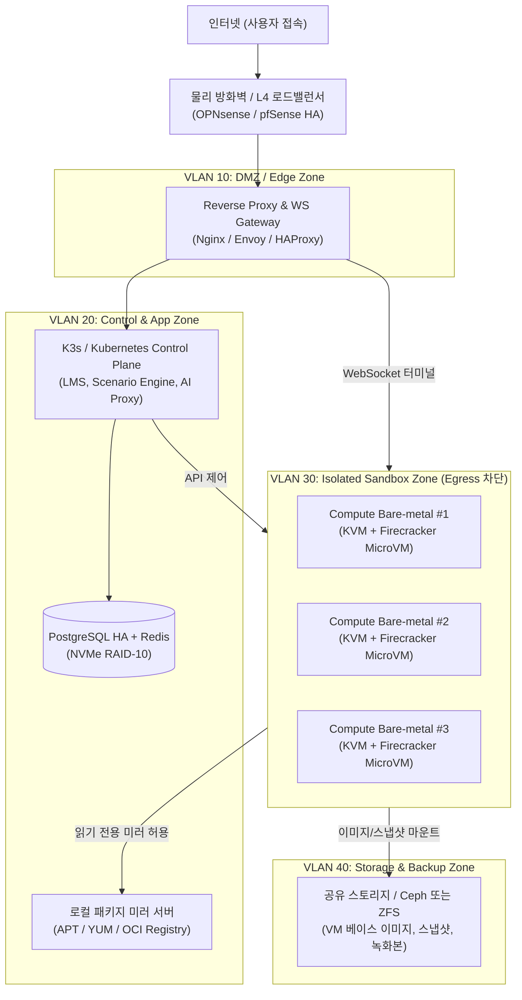

# [v0.2.0] B2C(개인 구독) 및 온프레미스(On-Premises) 인프라 상세 설계서

> **버전**: v0.2.0  
> **작성일**: 2026-11-22  
> **전제 조건**: B2C 개인 구독 모델 우선 / 자체 온프레미스 서버 환경 구축

---

## 1. B2C(개인 구독) 서비스 모델 및 핵심 기능

B2C 사용자는 **동기부여(재미/성장 체감)**, **즉각적인 피드백**, **커리어 증명(이직/포트폴리오)**에 민감합니다.

### 1.1 구독 티어(Pricing Tier) 설계
| 티어 | 월 구독료(예시) | 제공 범위 | 동시 실습 리소스 제한 |
| :--- | :--- | :--- | :--- |
| **Free (체험)** | 무료 | 주니어 입문 시나리오 3종, 커뮤니티 포럼 | 단일 VM (1 vCPU, 512MB RAM), 일 1시간 |
| **Pro (실무자)** | ₩29,000 ~ ₩39,000 | 주니어~시니어 전 시나리오 무제한, AI 멘토 힌트/포스트모템 리뷰, 터미널 리플레이 | 멀티 노드 최대 5VM (총 4 vCPU, 4GB RAM), 무제한 |
| **Executive (리더)** | ₩59,000 ~ ₩79,000 | Pro 전체 + **C레벨 위기관리 시뮬레이터**, 아키텍처 리뷰, 공식 역량 인증서 발급 | 복합 클러스터 + 고성능 AI 모델 우선 할당 |

### 1.2 B2C 특화 기능
- **게이미피케이션(Gamification)**:
  - 일일 장애 대응 챌린지(Daily Incident), 연속 학습 스트릭(Streak)
  - 레벨별 승급 심사(예: 주니어 → 중니어 승급 시 실전 모의 장애 3건 연속 해결)
  - MTTR(평균 복구 시간) 기반 글로벌/주간 리더보드
- **커리어 포트폴리오 연동**:
  - 해결한 주요 장애 시나리오의 **포스트모템(Post-mortem) 보고서**와 **6대 역량 레이더 차트**를 공개 URL(이력서/LinkedIn 첨부용)로 제공
- **가상 동료 AI 멘토**:
  - 혼자 공부할 때 막히는 지점을 방지하기 위해, 가상 시니어 동료에게 질문하면 정답을 바로 알려주지 않고 실무적인 디버깅 방향(예: "`dmesg`나 `journalctl -xe`를 먼저 확인해보셨나요?")을 제시

---

## 2. 온프레미스(On-Premises) 인프라 아키텍처

퍼블릭 클라우드 대비 **고정비(CapEx)로 고밀도 MicroVM을 저렴하게 운영**할 수 있는 온프레미스 베어메탈 아키텍처입니다.

### 2.1 물리 네트워크 및 서버 토폴로지

### 2.2 온프레미스 핵심 설계 원칙

1. **베어메탈 + Firecracker(또는 Kata Containers) 직접 구동**:
   - 온프레미스 물리 서버의 Linux KVM 위에서 MicroVM을 직접 실행하여 중첩 가상화(Nested Virtualization) 오버헤드를 완전히 제거합니다.
   - Copy-on-Write(ZFS 또는 LVM Thin Provisioning / OverlayFS)를 사용해 수백 개의 VM이 동일한 OS 베이스 이미지를 공유하면서도 디스크 공간과 I/O를 최소화합니다.
2. **엄격한 VLAN 기반 네트워크 격리**:
   - **VLAN 30 (Sandbox Zone)**은 외부 인터넷(Egress)으로 나가는 모든 패킷을 물리 방화벽(OPNsense)에서 원천 차단합니다.
   - 학습자가 `apt install` 또는 `dnf install`을 실행해야 하는 시나리오를 위해 **VLAN 20의 로컬 미러 서버(Mirror)**로 향하는 80/443 포트만 예외 허용합니다.
   - 학습자 세션 간(Inter-Session) 통신은 Linux Bridge / OVS(Open vSwitch) + VXLAN/eBPF(Cilium)로 완벽히 격리합니다.
3. **로컬 LLM vs 외부 LLM API 하이브리드**:
   - 일반 힌트/롤플레이 등 트래픽이 많은 호출은 외부 API(Gemini API 등)를 사용하거나, 추후 온프레미스 GPU 서버(예: RTX 4090 / L40S)를 추가해 비용을 통제할 수 있도록 AI Gateway 계층을 추상화합니다.

---

## 3. 온프레미스 하드웨어 사이징 가이드

MicroVM 1개당 평균 512MB~1GB RAM, 1 vCPU(오버커밋 비율 1:3 적용)를 가정한 권장 스펙입니다.

### 3.1 Phase 1: 초기 MVP (동시 접속자 50명 / 약 100~150 MicroVM)
| 서버 역할 | 대수 | 권장 스펙 (대당) | 비고 |
| :--- | :--- | :--- | :--- |
| **방화벽/라우터** | 1대 (권장 2대 HA) | 4 Core, 8GB RAM, 2.5G/10G NIC | OPNsense 설치 |
| **Control / DB / Mirror** | 1대 | 16 Core, 64GB RAM, 2TB NVMe (RAID-1) | 웹/API/DB/로컬 미러 통합 |
| **Compute (Sandbox)** | 2대 | AMD EPYC 32~64 Core, 128~256GB RAM, 4TB NVMe | Firecracker/KVM 전용 |
| **네트워크 스위치** | 1대 | L2/L3 Managed 10GbE 스위치 | VLAN 태깅 지원 필수 |

### 3.2 Phase 2: 성장기 (동시 접속자 300명 / 약 600~900 MicroVM)
- **Compute 노드**: 6~8대로 수평 확장 (Scale-out)
- **스토리지 분리**: Ceph 또는 TrueNAS(ZFS + 10GbE/25GbE 본딩) 전용 노드 구축
- **DB 및 Control Plane 이중화**: PostgreSQL Patroni HA + K3s 3-Node Control Plane

---

## 4. 온프레미스 운영 및 장애 대비 체크리스트
- **전력 및 회선**: UPS(무정전 전원장치) 필수, 기업용 고정 IP 인터넷 회선(최소 1Gbps 대칭형)
- **보안 모니터링**: Sandbox 노드의 비정상 CPU 점유(크립토마이닝) 및 내부 포트 스캔 탐지(Wazuh / Falco)
- **자동 복구**: 유휴 세션 15분 경과 시 자동 일시정지, 2시간 초과 시 강제 파기 및 ZFS 스냅샷 롤백
